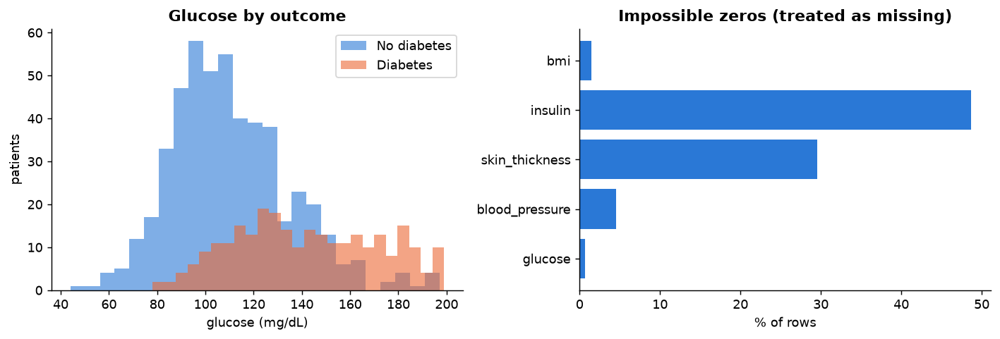
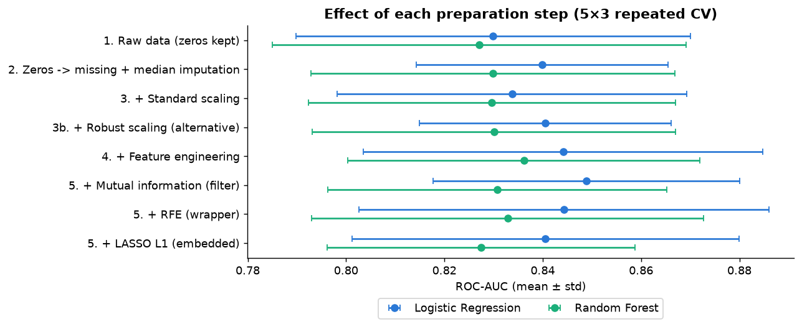
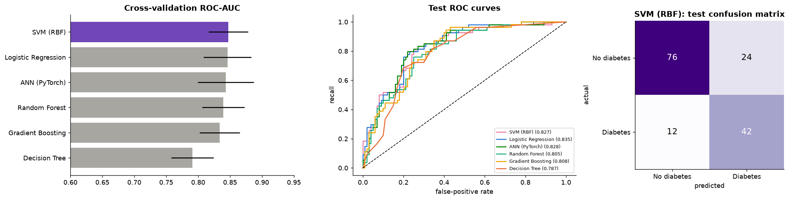
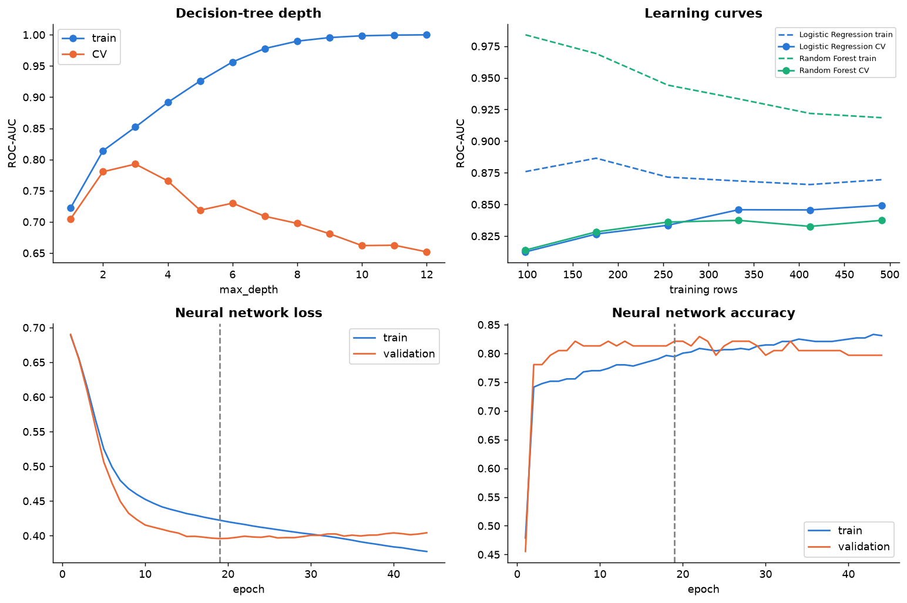
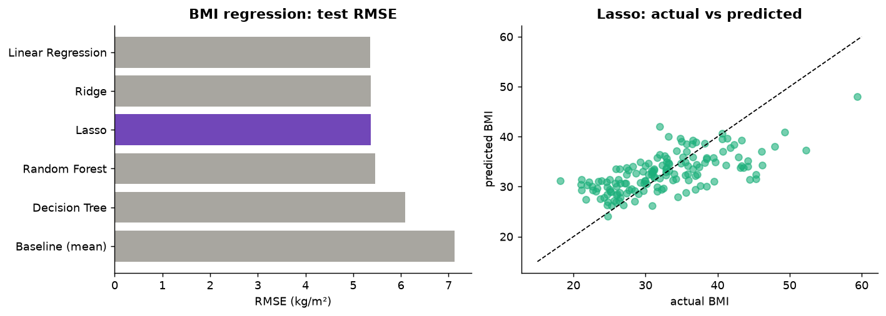

# Diabetes Prediction from Routine Clinical Measurements: A CRISP-DM Study on the PIMA Indians Dataset

## Abstract

This study builds and evaluates machine-learning models that identify diabetes from eight routine clinical measurements of 768 women of Pima Indian heritage. Following CRISP-DM, hidden missing values were repaired, four feature-engineering techniques and three feature-selection methods were compared, and five classifiers, a PyTorch feed-forward neural network and five BMI regressors (each against a baseline) were tuned with cross-validation. On a held-out test set the best classifiers reach a ROC-AUC of about 0.83; with a tuned decision threshold, SVM (RBF) detects 78% of diabetic patients at 76.6% accuracy. Simple, regularised models generalise as well as complex ones on this small dataset, and logistic regression offers the best balance of accuracy, stability and interpretability.

## 1. Introduction

Type 2 diabetes often remains undiagnosed for years, and early detection reduces the risk of complications. A model that ranks patients by risk from routine measurements can prioritise who receives a confirmatory test. This study has three objectives:

1. **Classification** – predict whether a patient has diabetes (main task).
2. **Regression** – predict body-mass index (BMI) from the other measurements (secondary task).
3. **Neural network** – compare a feed-forward neural network with classical models.

The work follows the six CRISP-DM phases (Chapman et al., 2000), which structure Sections 2 and 3.

## 2. Methodology

### 2.1 Business understanding

The model is intended as a screening tool, so a missed diabetic (false negative) is more costly than a false alarm. Model quality is therefore measured mainly with ROC-AUC (ranking quality) and recall, and every model is compared with a trivial baseline.

### 2.2 Data understanding

The dataset (Smith et al., 1988) contains 768 women aged 21 or older, eight numeric measurements and a binary outcome. 268 patients (34.9%) have diabetes, so a model that always predicts "no diabetes" is already 65.1% accurate; accuracy alone is therefore misleading. Several columns contain physiologically impossible zeros: insulin (374 rows), skin thickness (227), blood pressure (35), BMI (11) and glucose (5). Glucose is the strongest single signal (correlation 0.50 with the outcome; median 140 vs 107 mg/dL), and insulin and the diabetes pedigree function are strongly right-skewed.

### 2.3 Data preparation

- **Cleaning:** data types, duplicates and value ranges were checked (no rows removed); impossible zeros were converted to missing values.
- **Split:** a stratified 80/20 split gives 614 training and 154 test patients. The test set is used once, at the end; tuning, model selection and threshold choice use 5-fold stratified cross-validation (CV) on the training set.
- **Missing values:** median imputation, plus indicator columns that record whether a value was measured.
- **Encoding and normalisation:** one-hot encoding for binned features; standardisation for logistic regression, SVM and the neural network. Tree-based models are scale-invariant and use unscaled inputs.
- **Outliers:** 1.5 × IQR fences fitted on the training set flag 65 values, mostly in the pedigree function, insulin and blood pressure. These values are rare but physiologically plausible, so they are retained; robust scaling was tested as an alternative.
- **Leakage control:** every step is part of one scikit-learn pipeline (Pedregosa et al., 2011), so imputation and scaling are learned from the training folds only.

### 2.4 Feature engineering and selection

Four techniques were applied: a **log transform** of insulin and the pedigree function (insulin skewness 2.00 → −0.17), an **interaction term** glucose × BMI, **binning** of age (21–30, 31–40, 41–50, 51+) and BMI (WHO, 2000 classes), and **missing-value indicators**, giving 23 model inputs. Three selection methods, each retaining about ten inputs, were compared: a **filter** (mutual information), a **wrapper** (recursive feature elimination with logistic regression) and an **embedded** method (L1-regularised logistic regression, LASSO). Table 1 lists the ten highest-ranked inputs.

**Table 1.** Feature scores and selections (training set).

| feature | MI | LASSO coef | RF importance | MI kept | RFE kept | LASSO kept |
|---|---|---|---|---|---|---|
| glucose_x_bmi | 0.161 | 0.930 | 0.259 | ✓ |  | ✓ |
| glucose | 0.119 | 0.367 | 0.206 | ✓ | ✓ | ✓ |
| bmi | 0.092 | 0.000 | 0.092 | ✓ | ✓ |  |
| log_insulin | 0.064 | 0.000 | 0.051 | ✓ |  |  |
| age | 0.059 | 0.000 | 0.083 | ✓ | ✓ |  |
| age_band_21-30 | 0.046 | -0.661 | 0.031 | ✓ | ✓ | ✓ |
| bmi_class_normal | 0.037 | 0.000 | 0.012 | ✓ | ✓ |  |
| missingindicator_glucose_x_bmi | 0.033 | 0.000 | 0.000 | ✓ |  |  |
| missingindicator_skin_thickness | 0.031 | 0.000 | 0.005 | ✓ |  |  |
| age_band_31-40 | 0.029 | 0.000 | 0.007 | ✓ |  |  |

### 2.5 Modelling

**Table 2.** Models and tuning.

| Task | Models (GridSearchCV, 5-fold CV) |
|---|---|
| Classification | Baseline (class prior), Logistic Regression, Decision Tree, Random Forest, Gradient Boosting, SVM (RBF kernel) |
| Neural network | PyTorch (Paszke et al., 2019): inputs → 32 ReLU → dropout 0.2 → 16 ReLU → dropout 0.2 → sigmoid output; Adam, binary cross-entropy, batch size 32, weight decay, early stopping (patience 25) |
| Regression (BMI) | Baseline (mean), Linear Regression, Ridge, Lasso, Decision Tree, Random Forest |

Feature selection (Mutual information (filter)) is a tuned option in every classifier grid, so cross-validation decides whether it helps each model. The final classifier is the one with the highest mean ROC-AUC over 5-fold CV repeated three times; its decision threshold maximises F1 on out-of-fold predictions. For BMI regression, BMI and all BMI-derived features are excluded from the inputs.

### 2.6 Evaluation and deployment

Classification is evaluated with accuracy, precision, recall, F1 and ROC-AUC; regression with MAE, MSE, RMSE and R²; the neural network additionally with training and validation loss and accuracy per epoch. Bias and variance are analysed through train–CV gaps, a decision-tree depth curve and learning curves, and a 95% bootstrap interval is reported for test ROC-AUC. The trained pipelines are deployed in an interactive Streamlit dashboard.

## 3. Results

### 3.1 Effect of preparation and feature engineering

**Table 3.** CV ROC-AUC as each preparation step is added (5-fold CV, 3 repeats).

| variant | Logistic Regression | Random Forest |
|---|---|---|
| 1. Raw data (zeros kept) | 0.830 | 0.827 |
| 2. Zeros -> missing + median imputation | 0.840 | 0.830 |
| 3. + Standard scaling | 0.834 | 0.830 |
| 3b. + Robust scaling (alternative) | 0.840 | 0.830 |
| 4. + Feature engineering | 0.844 | 0.836 |
| 5. + LASSO L1 (embedded) | 0.841 | 0.827 |
| 5. + Mutual information (filter) | 0.849 | 0.831 |
| 5. + RFE (wrapper) | 0.844 | 0.833 |

### 3.2 Classification

**Table 4.** Cross-validated and test ROC-AUC.

| model | CV ROC-AUC | CV std | Train ROC-AUC | Test ROC-AUC |
|---|---|---|---|---|
| SVM (RBF) | 0.847 | 0.031 | 0.870 | 0.827 |
| Logistic Regression | 0.846 | 0.037 | 0.870 | 0.835 |
| ANN (PyTorch) | 0.843 | 0.044 | 0.874 | 0.828 |
| Random Forest | 0.839 | 0.033 | 0.918 | 0.805 |
| Gradient Boosting | 0.834 | 0.032 | 0.897 | 0.808 |
| Decision Tree | 0.791 | 0.033 | 0.884 | 0.787 |
| Baseline (prior) | 0.500 | 0.000 | 0.500 | 0.500 |

**Table 5.** Test-set metrics at each model's tuned threshold.

| model | threshold | accuracy | precision | recall | f1 | roc_auc |
|---|---|---|---|---|---|---|
| SVM (RBF) | 0.374 | 0.766 | 0.636 | 0.778 | 0.700 | 0.827 |
| Logistic Regression | 0.385 | 0.786 | 0.672 | 0.759 | 0.713 | 0.835 |
| ANN (PyTorch) | 0.297 | 0.747 | 0.597 | 0.852 | 0.702 | 0.828 |
| Random Forest | 0.317 | 0.721 | 0.575 | 0.778 | 0.661 | 0.805 |
| Gradient Boosting | 0.295 | 0.721 | 0.575 | 0.778 | 0.661 | 0.808 |
| Decision Tree | 0.409 | 0.734 | 0.600 | 0.722 | 0.655 | 0.787 |
| Baseline (prior) | 0.500 | 0.649 | 0.000 | 0.000 | 0.000 | 0.500 |

**SVM (RBF)** has the highest CV ROC-AUC (0.847 ± 0.031) and a test ROC-AUC of 0.827 (95% CI 0.754–0.887). At its threshold of 0.37 it detects 78% of diabetic test patients with 76.6% accuracy and F1 0.700; at the default threshold of 0.5 accuracy is 72.1%, but fewer diabetic patients are found. Permutation importance identifies **glucose** as the dominant input (ROC-AUC drop 0.128), followed by bmi and age.

### 3.3 Neural network and bias–variance

The neural network's validation loss is lowest at epoch 19 and rises afterwards while the training loss keeps falling, so early stopping restores the epoch-19 weights. Validation accuracy levels off at about 83%.

**Table 6.** Train vs CV ROC-AUC (a large gap indicates high variance).

| model | train_roc_auc | cv_roc_auc | gap |
|---|---|---|---|
| SVM (RBF) | 0.870 | 0.847 | 0.023 |
| Logistic Regression | 0.870 | 0.846 | 0.024 |
| ANN (PyTorch) | 0.874 | 0.843 | 0.030 |
| Gradient Boosting | 0.897 | 0.834 | 0.063 |
| Random Forest | 0.918 | 0.839 | 0.078 |
| Decision Tree | 0.884 | 0.791 | 0.093 |

### 3.4 Regression (BMI)

**Table 7.** BMI regression: test metrics and CV RMSE (kg/m²).

| model | MAE | MSE | RMSE | R² | CV RMSE |
|---|---|---|---|---|---|
| Baseline (mean) | 5.672 | 50.709 | 7.121 | -0.000 | 6.891 |
| Decision Tree | 4.780 | 37.111 | 6.092 | 0.268 | 5.822 |
| Lasso | 4.240 | 28.865 | 5.373 | 0.431 | 5.475 |
| Linear Regression | 4.239 | 28.748 | 5.362 | 0.433 | 5.496 |
| Random Forest | 4.348 | 29.882 | 5.466 | 0.411 | 5.503 |
| Ridge | 4.246 | 28.816 | 5.368 | 0.432 | 5.486 |

**Lasso** has the lowest CV RMSE and reaches a test RMSE of 5.37 and R² of 0.43, against 7.12 for the mean baseline. Skin thickness is the strongest predictor of BMI; both measure body fat.

## 4. Discussion

**How did preprocessing and feature selection affect generalisation?**
Treating impossible zeros as missing was the most valuable step: logistic-regression CV ROC-AUC rose from 0.830 to 0.840 and became more stable across folds. Scaling left the random forest unchanged, confirming that trees do not need it, while it is required for the SVM and neural network. Feature engineering improved both logistic regression (0.844) and random forest (0.836), and the engineered glucose × BMI term ranked first under all three scoring methods in Table 1. Mutual-information selection gave the best logistic score (0.849) with fewer than half of the inputs. All gains are smaller than the fold-to-fold standard deviation (about 0.03), so on this dataset preparation mainly made the models simpler and more stable rather than substantially more accurate.

**Which model type performed best, and why?**
SVM (RBF) achieved the highest CV ROC-AUC, but logistic regression (CV 0.846, test 0.835) and the neural network (CV 0.843) are equivalent within the uncertainty. The data are small, tabular and numeric, and the classes are separated by a smooth boundary driven mainly by glucose, so more flexible models add no benefit. Logistic regression is the preferred model for practical use: equally accurate, transparent and the least over-fitted. For BMI, the regularised linear models outperform the tree-based models.

**How did dataset size, feature quality and data type influence overfitting?**
With only 614 training rows, flexible models over-fit. An unrestricted decision tree reaches a train ROC-AUC of 1.000 but a CV ROC-AUC of only 0.652, whereas CV peaks at depth 3 (0.793). Even after tuning, the decision tree and random forest show the largest train–CV gaps (0.09 and 0.08), and the random-forest regressor has a train R² of 0.66 against a CV R² of 0.36. Feature quality is limited: insulin is missing for 49% of patients and skin thickness for 30%, so these inputs contribute little. Because all inputs are continuous and only moderately informative, the linear models, SVM and neural network show small gaps (0.02–0.03); their remaining error is due to bias and noise rather than variance. The learning curves are still rising slowly, so additional data would help.

**What recommendations follow for real-world healthcare analytics?**
(1) Train on larger and more diverse cohorts (men, other ethnic groups, multiple hospitals) and validate externally before use. (2) Prefer interpretable, well-calibrated models and set the decision threshold with clinicians according to the cost of a missed case. (3) Record missing measurements explicitly rather than as zeros. (4) Use the model as decision support with clinician review, and monitor its performance and fairness across patient groups after deployment.

**Limitations.** The dataset is small, historical and limited to one population; results come from a single random train/test split and have not been validated externally.

## 5. Conclusion

A complete CRISP-DM pipeline was developed: repair of hidden missing values, outlier analysis, four feature-engineering techniques, three feature-selection methods, five tuned classifiers, a feed-forward neural network and five BMI regressors, evaluated with repeated cross-validation, a held-out test set and bias–variance diagnostics. The best classifiers reach a test ROC-AUC of about 0.83 and, at the tuned threshold, detect about 78% of diabetic patients. Logistic regression offers the best balance of accuracy, stability and interpretability, and all results are available in an interactive dashboard.

## References

- Chapman, P., Clinton, J., Kerber, R., Khabaza, T., Reinartz, T., Shearer, C., & Wirth, R. (2000). *CRISP-DM 1.0: Step-by-step data mining guide*. SPSS Inc.
- Paszke, A., et al. (2019). PyTorch: An imperative style, high-performance deep learning library. *Advances in Neural Information Processing Systems, 32*.
- Pedregosa, F., et al. (2011). Scikit-learn: Machine learning in Python. *Journal of Machine Learning Research, 12*, 2825–2830.
- Smith, J. W., Everhart, J. E., Dickson, W. C., Knowler, W. C., & Johannes, R. S. (1988). Using the ADAP learning algorithm to forecast the onset of diabetes mellitus. *Proceedings of the Annual Symposium on Computer Application in Medical Care*, 261–265.
- World Health Organization. (2000). *Obesity: Preventing and managing the global epidemic* (WHO Technical Report Series 894).
- Dataset file: <https://raw.githubusercontent.com/jbrownlee/Datasets/master/pima-indians-diabetes.data.csv>
