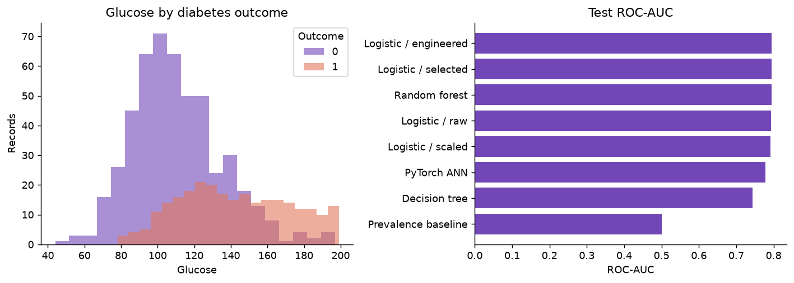
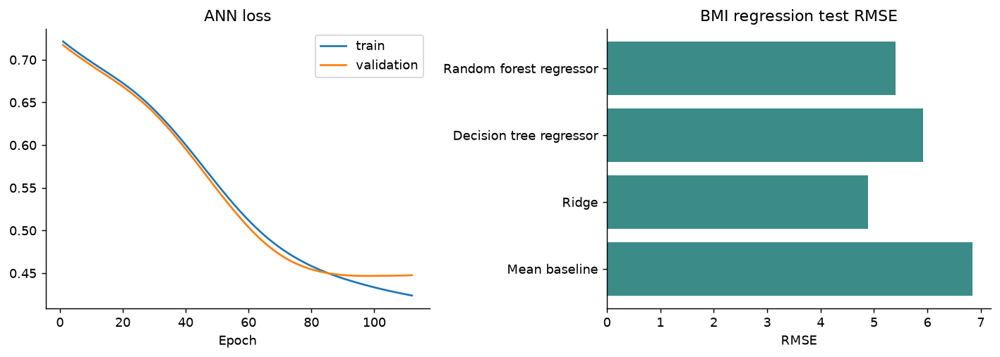

# PIMA Diabetes Prediction and BMI Regression

**Group details:** add before submission

## Introduction

This project applies CRISP-DM to the PIMA Indians Diabetes dataset used in Labs 1 and 3. Classification predicts the documented diabetes outcome. A separate regression experiment predicts BMI from the remaining measurements. A PyTorch neural network provides the required neural model. The objective is coursework comparison, not clinical diagnosis.

## Data understanding and preparation

The dataset contains 768 records, eight numeric predictors, and one binary outcome. There are 268 positive cases. The documented population consists of women aged at least 21 of Pima Indian heritage, limiting generalization.

Zeros in glucose, blood pressure, skin thickness, insulin, and BMI are physiologically invalid and are converted to missing values. Median imputation, missingness indicators, scaling, encoding, and selection are learned from training data inside pipelines. The stratified split contains 460 training, 154 validation, and 154 test records.

Engineered classification features are age bands, glucose × age, pregnancies ÷ age, and glucose × BMI. Embedded Extra Trees selection is compared with all engineered features. BMI regression excludes BMI and every BMI-derived feature from its inputs. Only recorded BMI values form its target.

Outliers are detected using 1.5 × IQR fences fitted on training measurements only. There are 59 flagged training measurements across features (not unique patients). Extremes are retained: unusual measurements may be clinically meaningful, and removing them without evidence could bias the population. Negative predictors, non-finite values, non-integer ages/pregnancy counts, invalid outcomes, and duplicate records are checked before splitting. Age bands are one-hot encoded; numeric variables use training medians and, where specified, standard scaling.

## Models and evaluation

Classification compares a prevalence baseline, four logistic variants, decision tree, random forest, and a 32–16 PyTorch ANN. Five-fold stratified cross-validation tunes classical classifiers. The validation set selects the model by ROC-AUC and selects an F1 threshold. The test set is reserved for reporting.

Regression compares a mean baseline, Ridge, decision tree, and random forest using five-fold cross-validation. Metrics are accuracy, precision, recall, F1, ROC-AUC, average precision, Brier score, MAE, MSE, RMSE, and R².

## Results

| model | accuracy | precision | recall | f1 | roc_auc | average_precision |
| --- | --- | --- | --- | --- | --- | --- |
| Prevalence baseline | 0.656 | 0.000 | 0.000 | 0.000 | 0.500 | 0.344 |
| Logistic / raw | 0.734 | 0.636 | 0.528 | 0.577 | 0.793 | 0.680 |
| Logistic / scaled | 0.740 | 0.651 | 0.528 | 0.583 | 0.792 | 0.681 |
| Logistic / engineered | 0.740 | 0.651 | 0.528 | 0.583 | 0.795 | 0.670 |
| Logistic / selected | 0.747 | 0.659 | 0.547 | 0.598 | 0.795 | 0.693 |
| Decision tree | 0.695 | 0.562 | 0.509 | 0.535 | 0.743 | 0.523 |
| Random forest | 0.734 | 0.625 | 0.566 | 0.594 | 0.795 | 0.643 |
| PyTorch ANN | 0.727 | 0.612 | 0.566 | 0.588 | 0.779 | 0.627 |

The validation-selected classifier is **Logistic / raw**. Its test ROC-AUC is **0.793**, average precision **0.680**, and recall **0.528** at threshold 0.50. At the validation-selected threshold 0.195, test F1 is 0.626. The bootstrap 95% ROC-AUC interval is 0.724–0.861.

| model | mae | mse | rmse | r2 |
| --- | --- | --- | --- | --- |
| Mean baseline | 5.416 | 46.858 | 6.845 | -0.003 |
| Ridge | 3.850 | 23.881 | 4.887 | 0.489 |
| Decision tree regressor | 4.655 | 35.100 | 5.925 | 0.249 |
| Random forest regressor | 4.286 | 29.170 | 5.401 | 0.376 |

The selected BMI regressor is **Random forest regressor**, with test RMSE **5.401** and R² **0.376**. Performance must be judged against the mean baseline. BMI prediction is an academic secondary task, not a replacement for measurement.

## Discussion

### How did preprocessing and feature selection affect generalization?

The controlled ablation holds logistic C=1, the data split, and CV folds fixed. Its validation ROC-AUC and training-fold CV results are:

| variant | roc_auc | cv_mean | cv_std |
| --- | --- | --- | --- |
| Raw | 0.865 | 0.829 | 0.046 |
| Scaled | 0.862 | 0.823 | 0.045 |
| Engineered | 0.859 | 0.832 | 0.050 |
| Selected | 0.861 | 0.841 | 0.044 |

Scaling changes validation ROC-AUC by -0.0028; engineering changes it by -0.0024; selection changes it by +0.0013. The final tuned selector retains 12 of 23 transformed columns. These are observed differences on one split, not significance claims. Scaling also changes the effective regularization penalty. The separately tuned leaderboard is not a controlled ablation.

### Which model performed best and why?

Logistic / raw has the highest validation ROC-AUC among the candidate classifiers; Random forest regressor has the lowest validation RMSE among regressors. Classification and regression metrics answer different questions and cannot identify one winner across tasks. A plausible explanation for competitive logistic performance is that this small numeric dataset supports a relatively simple decision boundary; the experiment does not prove this mechanism. The ANN uses dropout, weight decay, and early stopping, with best checkpoint at epoch 97.

### How did size, quality, and data type influence overfitting?

Only 460 observations train the classifiers. Insulin and skinfold missingness reduces effective information; correlated interactions add complexity. Numeric measurements plus engineered categorical age bands require different transformations. Train/validation ROC-AUC gaps quantify overfitting evidence:

| model | train | validation | train_minus_validation |
| --- | --- | --- | --- |
| Decision tree | 0.915 | 0.763 | 0.153 |
| Logistic / engineered | 0.873 | 0.853 | 0.020 |
| Logistic / raw | 0.853 | 0.865 | -0.012 |
| Logistic / scaled | 0.854 | 0.862 | -0.008 |
| Logistic / selected | 0.862 | 0.855 | 0.006 |
| Prevalence baseline | 0.500 | 0.500 | 0.000 |
| PyTorch ANN | 0.864 | 0.861 | 0.003 |
| Random forest | 0.974 | 0.835 | 0.140 |

A larger positive gap is consistent with overfitting, but neither a single gap nor a single-seed learning curve estimates variance reliably. Increasing training data, constraining tree depth/leaf sizes, and using ANN dropout can reduce variance. The existing learning curves use fixed tuned settings and are descriptive. Five-fold CV tunes classical candidates; the ANN instead uses the validation set for early stopping. Sharing validation for early stopping, winner selection and threshold choice can make validation results optimistic. No settings are selected using test scores, but the test set has been inspected during development, so fresh external validation remains necessary.

### What is recommended for real-world healthcare analytics?

Use representative, consented, externally validated data; investigate missingness mechanisms and subgroup performance; validate calibration and select thresholds against explicitly agreed costs. Add prospective monitoring, human review and privacy controls. A threshold chosen for F1 does not encode clinical harm or establish clinical suitability. The app's single-feature sensitivity and what-if plots describe associations in the fitted model, not treatment effects.

The dataset is small, historical, and population-specific. Missing measurements may not be missing at random. A random split does not test future or external populations. Real deployment would require broader data, external validation, calibration, subgroup evaluation, and clinical review.

## Conclusion

The project implements the complete required pipeline: cleaning, feature engineering, embedded selection, classification, regression, neural-network training, bias–variance diagnostics, and Streamlit visualization. Results support comparison of methods on this dataset only.

## References

- [PIMA dataset CSV](https://raw.githubusercontent.com/jbrownlee/Datasets/master/pima-indians-diabetes.data.csv)
- [Dataset documentation](https://raw.githubusercontent.com/jbrownlee/Datasets/master/pima-indians-diabetes.names)
- Local Machine Learning Labs 1 and 3 and project brief.
- [scikit-learn common pitfalls](https://scikit-learn.org/stable/common_pitfalls.html)
- [PyTorch optimization tutorial](https://docs.pytorch.org/tutorials/beginner/basics/optimization_tutorial.html)
